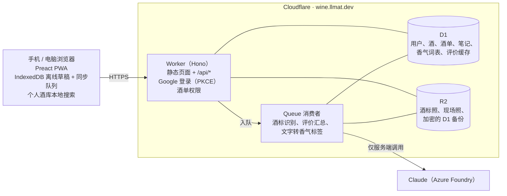

# 品酒日记 · 设计方案

> 2026-11-17 · Ke Li
>
> 这是动工前的设计文档，代码落地后以代码为准并同步更新本文。第一期已实现（2026-11-18），与本文不同之处见文末“第一期实现说明”。视觉样稿（七个中文界面加三个英文界面，可切换深浅主题）：<https://claude.ai/artifact/UQ9zKnuipopKTk1jcozQUH>（私有链接，需作者分享后才能打开）。

## 1. 一页摘要

品酒日记是一个手机优先的 web app（可装到主屏幕的 PWA）：在酒庄现场用 30 秒记下一款酒，回家后变成可搜索的个人酒库，并能和同行的朋友在同一份酒单下互看感受。技术上照搬羽毛球网站（[likefudan/jaysbadminton](https://github.com/likefudan/jaysbadminton)）的做法：一个 Cloudflare Worker（Hono + Preact + D1），加 R2 存照片，Google 登录沿用同一套代码。

核心设计决策：

- **零基础也能上手的引导品鉴（核心特色）**。现有的品酒网站都过于专业，新手很难入手。这里同一张品鉴表有入门、进阶、专业三个深度：入门用大白话提问（“喝完嘴里发干吗？”），不出现术语，答完后把回答翻译成一段专业品酒词；进阶按 WSET 系统品鉴法走；专业开放全部字段和盲品猜酒。另有“快记”，10 秒记一款，适合一下午上 8 款酒。
- **一切以“酒”为主键**。每条品鉴都挂在一款具体的酒（酒庄 + 酒名 + 年份）上，而不是一段文字。这样以后搜索、酒窖“以前喝过吗”、推荐都能直接用。
- **香气用同一套词表**。自己的笔记、朋友的笔记、专业评价都映射到同一棵香气词表（黑醋栗、雪松、烟草……）。这是以后算“我和专业品酒师的差异”和做推荐的基础，所以第一版就要定下来。
- **酒单 = 一次 trip 或一次品鉴**，可设私密、只读分享或可写分享，扫二维码加入。默认开“盲评”：自己交卷之前看不到别人的评分，避免被带偏。
- **离线优先**。酒庄品酒室信号常常很差，记录先存手机本地，有网再同步。
- **三种语言**：简体、繁體、English，从第一期就做。

已定的事项：

| 事项 | 决定 |
| --- | --- |
| 专业评价来源 | Claude 联网检索汇总（两站页面无法直接读取，2026-11-18 试验确认），社区均分取自 CellarTracker、参考价取自 Wine-Searcher，按需查、按酒缓存；另给“复制提示词”按钮，让用户用自己的 AI 免费查；付费 API 以后可加。见 3.2 |
| 打分制 | 100 分制，结构上用 WSET 的品鉴步骤 |
| 深度切换 | 每人一个默认深度；品鉴中随时切换，只对当前这款酒生效 |
| 语言 | 简体、繁體、English |
| 域名 | 暂定 `wine.llmat.dev`，和羽毛球网站同一个主域名 |

## 2. 整体架构

和羽毛球网站一样，一个 Cloudflare Worker 同时提供页面和 API，数据在 D1。新增的只有 R2（存照片）、Queues（异步 AI 任务）和 AI 识别。

技术选型逐项对齐羽毛球网站，可以直接拷贝骨架：

| 部分 | 选择 | 与羽毛球网站的关系 |
| --- | --- | --- |
| 运行时 | Cloudflare Workers + 静态资源 | 相同 |
| 路由 | Hono | 相同 |
| 数据库 | D1 + 编号 SQL migrations | 相同；不用 FTS5，原因见下 |
| 前端 | Preact + preact-iso + Vite，不用 CSS 框架 | 相同；字体换成为酒主题选的衬线体 |
| 登录 | Google OAuth（PKCE + jose 验证 ID token），HttpOnly cookie 会话 30 天 | 直接复用 `googleAuth.ts`，去掉会员链接和管理员密码那一套 |
| 照片 | R2 私有桶，客户端压缩到 1600px 再传 | 羽毛球网站只用 R2 存备份，这里新增 |
| AI | Claude via Azure Foundry（酒标识别、评价汇总、文字转香气标签） | 复用 `ai.ts` 的模型配置方式 |
| 异步任务 | Cloudflare Queues | 新增 |
| 二维码 | `qrcode` 包，浏览器内生成 | 相同 |
| 离线 | PWA + IndexedDB 草稿队列 | 羽毛球网站有 `offline.ts`，这里要做得更重 |
| 多语言 | `lang.ts` / `i18n.ts` / `messages.ts` | 相同机制，见 3.8 |
| 测试与发布 | Vitest + Playwright；main → staging，`v*` tag → 生产；Biome | 相同 |

要点和约束：

- **身份更简单**。只有 Google 登录，没有会员链接和管理员密码。未登录的人只能打开“链接可看”的酒单。
- **谁能登录、AI 花多少钱要有上限**。只有 Google 登录意味着任何人都能注册并触发 AI 调用。做法：新用户必须经酒单二维码邀请或在白名单内；每人每天 AI 次数有上限（例如 40 次），全站设月度预算，超出后退回手动输入。站长是唯一的管理员，可以合并重复的酒。
- **AI 只在服务端调用，并且异步**。拍完酒标先存照片和一条“识别中”的记录，用户可以继续记笔记，几秒后酒的信息自动补上。任务走 Cloudflare Queues 而不是 `waitUntil`：`waitUntil` 在响应发出后最多只能再跑 30 秒，联网汇总评价很可能超时；Queue 消费者有 15 分钟，免费套餐可用。
- **不用 FTS5**。D1 的导出不支持带虚拟表的数据库，会让羽毛球网站那套加密备份脚本失效；而且 FTS5 默认分词不认中文，也不容忍拼写错误。个人酒库只有几百到几千行，登录后整份同步到手机本地搜索，更快、离线可用。全站酒目录用归一化名字做前缀匹配。
- **协作不需要实时连接**。朋友一起品酒时，酒单页打开期间每 15 秒拉一次更新就够了，不必上 Durable Objects。
- **离线**。品鉴笔记先写进 IndexedDB，每条带客户端生成的 ID，有网时按顺序上传，服务端按 ID 去重，所以重发不会产生重复。离线时拍的酒标也先存本地，恢复网络后再识别。iPhone 上没装到主屏幕的网页，本地数据闲置约 7 天可能被系统清掉，而且没有后台同步，所以草稿只在打开 app 时上传，界面要一直显示“还有 3 条未同步”。
- **微信内置浏览器不能用 Google 登录**。朋友用微信扫码会卡住，直接复用羽毛球网站的 `WeChat.tsx`，提示“在 Safari 中打开”。
- **免费额度够用**。几个人用，每天几百次请求；R2 免费 10 GB 大约能存 2 万张压缩后的酒标照。只有 AI 调用花钱。

## 3. 功能设计

主入口只有三个：**酒单**（首页）、中间一个大的 **＋记一杯** 按钮、**酒库**（搜索我喝过的所有酒）。**我的**（口味画像、成长记录、设置）从右上角头像进入。酒窖在第三期加入底部栏。在酒庄里最常见的操作是“在当前酒单里加下一款酒并打分”，这条路径要做到 3 步以内。

### 3.1 确定一款酒

- **输入联想**：输入酒庄或酒名的任意部分，先查我自己喝过的（酒库同步在手机本地，离线可搜，容忍拼写错误），再查全站已有的酒（服务端前缀匹配）。都没有时，让 AI 按输入猜出结构化候选（酒庄、酒名、产区、品种、颜色），用户确认后入库。
- **拍酒标**：拍照后 Claude 读出酒庄、酒名、年份、产区、酒精度，并和已有酒匹配。做法是先按名字取出最接近的几款候选，让 Claude 在候选里选一个或判定为新酒，最后由用户点一下确认，避免目录里出现重复的酒。照片留做这次品鉴的封面。
- **酒和年份分开存**：“Opus One”是一款酒，“Opus One 2019”是它的一个年份。搜索时能看到“这款酒我喝过 3 个年份”。
- **去重**：酒庄名 + 酒名做归一化（小写、去重音符、去掉 Winery / Vineyards 等词）得到一个 key，重复时提示合并。

### 3.2 专业评价与香气 notes

2026-11-18 用 22 款酒做了数据源试验，记录见 [review-spike.zh.md](review-spike.zh.md)。结论：Wine-Searcher 和 CellarTracker 的页面不能用程序直接读（前者 PerimeterX 拦截，后者 AWS WAF 质询，Claude 的网页读取也被拒，22 款全部失败），绕过拦截又违反两站条款，所以不做。Claude 联网检索可以用：22 款里 21 款拿到了评论家分数，18 款拿到 CellarTracker 社区均分，19 款拿到 Wine-Searcher 参考价，两站的直达链接也基本都能找到。下面的方案按这个结论定。

- **怎么查**：第一次有人打开某款酒某个年份的专业评价时，放进 Queue，由 Claude Sonnet 5.5 加联网检索（Azure Foundry 上是 `web_search_20250305`，最多 5 次搜索）去查，用结构化输出（JSON schema）直接拿到字段。一次约 16 秒（最慢 36 秒）、约 $0.21。页面先显示“正在查找”，查完自动刷新。不直接请求 Wine-Searcher 或 CellarTracker，也不用网页读取。Haiku 5.5 便宜很多（约 $0.03），但漏掉的评论家多、偶尔来源对不上，先不用；以后可以像拍酒标那样做成可选模型。
- **存什么**（每款酒每个年份一行，全站共享）：
  - 评论家分数，每条一行：刊物（Wine Advocate、Vinous…）、评论人（同一刊物常有不止一位）、分数**按原样存成文字**（`97-99`、`98+`），来源网址和域名，一句不超过 15 个词的原文摘录（只用于校验，不展示）。
  - 社区均分和条数，固定来自 CellarTracker，附它的酒款链接。
  - 参考价（美元），固定来自 Wine-Searcher，附链接和查询日期。
  - 适饮期、映射到香气词表的香气标签、一段用自己的话写的 3 句话摘要。
  - Wine-Searcher 和 CellarTracker 的酒款页链接（试验里 21/22 和 20/22 能找到），找不到时用站内搜索链接代替。
- **服务端校验**，不通过的分数直接丢掉，不展示：来源网址必须出现在这次的搜索结果里；摘录里必须有这个分数。这样落实下面第 1 条硬规则，而不是只靠提示词。
- **怎么展示**：按刊物分组，同一刊物多位评论人都列出来并写名字；区间分照原样显示；每个分数都能点到来源。来源是零售商转引时标一个小字“经 wine.com 转引”。不把多家分数平均成一个“专业分”。
- **只按需查、每款只查一次、全站共享缓存**，90 天后可手动刷新（价格最容易变）。不做批量预查。以后接 Wine-Searcher 付费 API 时只是多一个来源，表结构不变。
- **复制提示词（免费备选，Ke Li 2026-11-18 定）**：每款酒的专业评价区放一个“用自己的 AI 查”按钮，复制一段写好的提示词（含酒庄、酒名、年份，要求联网、只报原文出现的分数、附来源链接），用户粘贴到 ChatGPT、Claude 等自己的 AI 里，费用由用户自己承担。提示词要求 AI 最后输出一段固定格式的结果，用户可以粘贴回来，网站解析后存下。粘贴回来的内容标“用户导入，未核实”，只自己可见，不进全站缓存，也不参与香气对比和推荐的统计。适合当天查询配额用完，或者想自己深挖的时候用。提示词按界面语言出简体、繁體、English 三版。
- **盲评保护**：品鉴时默认折叠专业评价，提交自己的笔记后再展开对比。这样记下的才是自己的感受，推荐也才准。
- **第一版实现（2026-11-18）**：入口在酒库里每款酒的页面（`/wine/:id`）底部的“专业评价”区，还没记过这款酒时先折叠。查询没有走 Queue，而是在请求里直接跑（中位 16 秒），同时交给 `waitUntil`，手机离开页面后还有 30 秒把结果存下；同一款酒同时只会有一个查询，别人看到“正在查找”并每 4 秒刷新。限额：每人每天新查 5 款（站长 30 款），已查过的随便看；全站每月 300 款（约 $63，可在 settings 表 `review_monthly_limit` 改）；失败后 10 分钟内不重试。“报告错误”存进 `pro_review_reports` 表。代码：`src/worker/reviews.ts`、`src/shared/reviews.ts`、`src/web/Reviews.tsx`。

两条硬规则不变：

1. 分数只显示来源里原文出现的数字，查不到就显示“未找到”，不让模型估。
2. 只存分数、简短摘要和链接，不存整段酒评原文。

**还要注意的风险**：分数大多来自零售商转引而不是评论家原站，个别零售商会把桶边区间分写成单个数字，评论人也偶尔归错；同一款酒查两次，个别分数会差 1 分。所以界面上要能看到来源，并给一个“报告错误”的入口。条款方面，展示少量分数、均分和价格并附链接属于引用事实，风险较低；不要把 CellarTracker 的社区笔记或评论家的酒评原文搬进来。

### 3.3 品鉴打分表

结构采用 WSET 系统品鉴法（SAT）的四步，打分用 100 分制。下表是进阶深度看到的完整结构；入门和专业是它的简化版和扩展版，数据存在同一套字段里，所以快记或入门记下的内容以后都能再补全。

| 步骤 | 记录内容 | 引导提示（示例） |
| --- | --- | --- |
| 外观 | 颜色深浅（浅 / 中 / 深）、色调（红：紫 / 宝石红 / 石榴红 / 褐；白：柠檬绿 / 柠檬 / 金 / 琥珀） | 把杯子斜放在白纸前，看杯沿的颜色 |
| 闻香 | 强度；香气标签分一类（果、花、草本、香料）、二类（橡木桶、黄油、面包）、三类（皮革、烟草、泥土、果干） | 先不摇杯闻一次，再摇杯闻一次；先判断是红色果还是黑色果 |
| 入口 | 甜度、酸度、单宁、酒精、酒体、余味长度 | 单宁看牙龈发不发干；余味从吞下开始数秒 |
| 结论 | 我的分（100 分制，记的是我有多喜欢）、还会买吗、买了几瓶、价格、一句话；品质等级 | “我的分”记个人喜好，“品质等级”记客观判断，推荐用的是前者 |

- **快记**：一屏搞定。拖动打分、点最多 5 个香气标签、写一句话（用手机键盘自带的听写），10 秒内完成。
- **自由文字也能结构化**：只写了一句“很多黑樱桃和雪茄盒，单宁有点紧”时，AI 在后台把它拆成香气标签和单宁值，由用户确认。
- 全程用点选和滑块代替打字，站在吧台前也能单手操作。
- 快记没有记录外观时，“杯中色”按酒的类型（红 / 白 / 桃红）和年龄给一个默认色。

### 3.4 三个深度：入门、进阶、专业

这是这个 app 和现有品酒网站最大的区别：不要求用户先懂术语，而是边喝边教，同时给中高级用户足够的深度。同一份酒单里，新手朋友用入门、老手用专业，结果仍然能放在一起比。

| 深度 | 适合谁 | 怎么问 | 一款酒用时 |
| --- | --- | --- | --- |
| 入门 | 第一次认真品酒的人 | 6 到 8 个大白话问题，每题 3 个大选项加“说不上来”，没有术语 | 约 1 分钟 |
| 进阶 | 喝过一些、想建立体系的人 | WSET 四步，滑块加香气标签，每步一条提示 | 2 到 3 分钟 |
| 专业 | 老手 | 四步的全部字段，加缺陷、侍酒条件、盲品猜酒 | 不限 |

**入门深度的设计原则**

- **问身体感觉，不问术语**。不问“单宁高低”，问“喝完后牙龈和舌头发干、发涩吗？”；不问“酸度”，问“和柠檬水比，流口水吗？”；不问“酒体”，问“在嘴里更像脱脂奶、全脂奶还是奶油？”；余味就让人吞下后数秒。答案在后台映射到和进阶相同的刻度。
- **颜色直接点色块**。给出几个“杯中色”圆点，点最像的那个。
- **香气从大类往下找**。不给一整面墙的标签。先问“更像水果、花、香料和木头，还是泥土和皮革？”，选了水果再问“红色的果子还是黑色的？”，最后才给 4 到 5 个具体的词，每个词配一句生活里的联想（“雪松：削铅笔的味道”）。闻不出来可以跳过。
- **和上一款比**。新手很难给绝对值，但能说出“这款比上一款更涩”。酒单里从第二款开始提供这种对比题。
- **每题一句“为什么问这个”**。例如“发干的感觉来自葡萄皮里的单宁，它让红酒能陪伴牛排，也让酒能陈年”。术语只在这里出现，点一下有词条解释。
- **答完后翻译成专业品酒词**。结尾显示“你刚才描述的是：深宝石红，黑色水果和雪松香气，高单宁，中高酸度，余味长”。用户看到自己的感受和专业语言是怎么对上的，这一步就是学习。
- **对照专业评价再闻一次**。提交后提示“酒评里提到了可可，再闻一次，找得到吗？”，答“找到了 / 没找到”。既训练鼻子，又为口味画像增加数据。
- **没有对错**。不打分、不判题，文案上始终说“你的感受”。每题都能选“说不上来”。
- **慢慢升级**。入门记满大约 10 款后，提示可以试试进阶；也可以单独把某一步（比如香气）先升级。“我的”页显示已经认识的香气和喝过的品种，作为成长记录。

入门深度的题目和解释都是预先写好、随代码发布的（按红 / 白 / 起泡分几套），不依赖 AI，所以没信号也能用。这部分文案的质量决定了特色成不成立，需要找两三位真正的新手试用后反复改。

**专业深度比进阶多出的内容**

- 外观：澄清度、杯沿颜色变化、挂杯、沉淀。
- 闻香：每个香气的强度、自定义香气词、发展阶段（年轻、发展中、成熟、已过巅峰）。
- 入口：单宁拆成“量”和“质感”（细腻、颗粒感、粗糙、青涩），气泡质感，风味强度，余味精确到秒，平衡感。
- 结论：适饮期，品质等级的理由（平衡、长度、强度、复杂度）。
- 缺陷记录：木塞味、氧化、还原、酒香酵母、挥发酸。
- 侍酒条件：醒酒多久、酒温、杯型、开瓶后第几天。
- 盲品猜酒：先猜品种、产区、年份，再揭晓答案，长期统计命中率。
- 自由格式长笔记，以及同一款酒在一小时内的多次记录。

**深度怎么选、怎么换**

- 第一次登录时问一句“你平时怎么喝酒？”，选出默认深度，以后可在“我的”里改。经二维码加入的朋友默认是入门。
- 品鉴页右上角随时切换深度，已答的内容带过去。切换只对当前这款酒生效；连续切换三次后问一句“以后默认用进阶吗？”。
- 记完的酒以后可以用更高的深度重新打开补全。

### 3.5 酒单（一次 trip 或一次品鉴）

- 酒单有标题、日期、封面图、类型（酒庄品鉴 / 旅行 / 饭局 / 在家）。一次 trip 可以包含多个酒庄，每个酒庄是一“站”。
- 酒单里的酒有顺序（就是上酒顺序），可拖动。每款酒显示我的分、大家的平均分和一个“杯中色”小圆点。
- 结束后自动生成一张“酒单卡片”：按得分排序、标出大家分歧最大的一款，可长按保存发微信。

### 3.6 分享与协作

| 可见性 | 谁能看 | 谁能写 |
| --- | --- | --- |
| 私密（默认） | 只有我和已加入的成员 | 成员 |
| 链接可看 | 任何拿到链接或扫到二维码的人，不用登录 | 成员 |
| 链接可写 | 同上 | 扫码并用 Google 登录后自动成为成员 |

- 二维码里是 `/l/{酒单号}?k={分享密钥}`。密钥可重新生成（旧码立即失效），可设过期时间（例如 trip 结束 3 天后关闭加入）。密钥除了存哈希，还要加密存一份（沿用羽毛球网站的 `TOKEN_KEY` 做法），否则以后无法再次显示同一个二维码。
- 每人对每款酒写自己的一份笔记，只有本人能改。成员都能往酒单里加酒；创建者可以移除任何酒和成员。
- **盲评**（默认开）由服务端执行：我没提交的那款酒，接口不返回别人的分数和笔记，只显示“3 人已评”。未登录的只读访客在酒单“揭晓”之前只能看到酒单和酒，看不到任何人的评价，否则开个无痕窗口就能偷看。
- “链接可看”的酒单会把成员的名字和笔记公开给拿到链接的人，切换到这一档时要明确提示所有成员。
- 朋友的笔记也进入朋友自己的酒库；酒单创建者删除酒单时，朋友的笔记保留在朋友的酒库里。

### 3.7 酒库与搜索

- 一个搜索框搜酒名、酒庄、产区、品种、酒单名、笔记原文。筛选：颜色、品种、产区、年份、得分段、“还会买”。
- 按香气找酒：“我喝过的有紫罗兰香的酒”。
- 一款酒的详情页汇总：我每次喝它的记录（不同年份、不同场合）、朋友的评价、专业评价，以及“我和专业评价重合的香气 / 我没闻到的 / 我独有的”。
- 导出：CSV 和 JSON，数据永远是用户自己的。

### 3.8 语言：简体、繁體、English

机制沿用羽毛球网站（`lang.ts` / `i18n.ts` / `messages.ts`）：代码里写简体中文并以它为 key，`t("酒单")` 查表得到繁体和英文，测试检查每条文案都有翻译。和羽毛球网站有四处不同：

- **默认语言跟手机走，英文手机默认英文**。羽毛球网站对英文手机仍显示简体，因为群友都读中文；这里一起品酒的朋友可能不读中文。语言选择存在账号上，换设备不丢。
- **繁体不能只做字形转换**。酒的词汇两岸不同，例如赤霞珠在台湾叫卡本內蘇維濃，霞多丽叫夏多內。界面文案可以用 OpenCC 转换后人工过一遍，但品种名、产区名和香气词表要单独维护繁体一列。
- **入门引导的题目要按语言重写，不是翻译**。大白话的类比依赖生活经验：中文说“像咬了一口没熟的柿子”，英文要换成 walnut skin、black tea 之类英语读者熟悉的东西。这是三语里工作量最大的一块。
- **内容的语言和界面的语言分开**。酒名、酒庄名始终显示原文。香气标签存的是词表 ID，所以朋友用英文点的 cedar，在中文界面显示为雪松，跨语言也能比较。专业评价的摘要由 AI 一次生成中英两版并缓存，繁体由简体转换。朋友手写的一句话保留原文，旁边给一个“翻译”按钮。

## 4. 数据模型

酒的目录（酒庄、酒、年份、专业评价）全站共享，个人数据（酒单、笔记）按用户隔离。所有 ID 用客户端可生成的 ULID，这样离线创建的记录上传时不会重复。

| 表 | 主要字段 | 说明 |
| --- | --- | --- |
| `users` | id, google_sub (unique), email, name, picture, locale, level（默认品鉴深度）, role, invited_via, created_at | 只有 Google 登录 |
| `sessions` | id_hash, user_id, expires_at | 沿用羽毛球网站的做法 |
| `producers` | id, name, name_key, country, region, website | 酒庄 |
| `wines` | id, producer_id, name, name_key, color（red/white/rosé/sparkling/dessert）, appellation, grapes (JSON), created_by | 一款酒，不含年份；(producer_id, name_key) 唯一 |
| `vintages` | id, wine_id, year（NV 为 0）, abv, label_photo | 一款酒的一个年份 |
| `pro_reviews` | id, vintage_id, source（wine-searcher / cellartracker / winery / other）, reviewer, score, score_max, url, fetched_at | 一条评价一行；评分区间在显示时计算，每个数字都能点回原文 |
| `vintage_facts` | vintage_id, community_avg, community_n, price_usd, drink_from, drink_to, summary (JSON，按语言), fetched_at | 每个年份一行的汇总信息 |
| `descriptors` | id, tier（一类/二类/三类）, family（黑色果、橡木…）, name_zh, name_tw, name_en, hint_zh, hint_tw, hint_en, synonyms | 香气词表，约 120 个词，随代码发布；hint 是大白话联想 |
| `review_descriptors` | vintage_id, descriptor_id | 专业评价里提到的香气 |
| `lists` | id, owner_id, title, kind, starts_on, ends_on, cover_photo, visibility（private/view/contribute）, share_key_hash, share_key_enc, share_expires_at, blind, revealed_at | 酒单 |
| `list_stops` | id, list_id, producer_id, name, visited_on, position | 酒单里的一站（一家酒庄或一个地点） |
| `list_members` | list_id, user_id, role（owner/member）, joined_at | 协作成员 |
| `list_items` | id, list_id, stop_id, vintage_id, position, price_usd, added_by | 酒单里的一款酒 |
| `tastings` | id, user_id, vintage_id, list_item_id（可空）, tasted_at, depth（quick/beginner/standard/expert）, appearance (JSON), nose (JSON), palate (JSON), quality, score, buy_again, bought_qty, guesses (JSON), note, photo, status（draft/done）, updated_at | 一人对一款酒的一次品鉴；(list_item_id, user_id) 唯一 |
| `tasting_descriptors` | tasting_id, descriptor_id, intensity（1–3） | 拆成行，方便统计和推荐 |
| `photos` | id, user_id, r2_key, kind（label/glass/scene）, width, height | R2 里的图片 |
| `ai_jobs` | id, user_id, kind（label/reviews/parse_note）, target_id, status, model, cost_usd, error | 异步 AI 任务、花费记录和每日上限的依据 |

为未来功能预留的两张表（第一版不建，只是确认现在的结构能接上）：

| 表 | 主要字段 | 靠什么接上 |
| --- | --- | --- |
| `cellar_items` | id, user_id, vintage_id, qty, location, bought_on, price_usd, drink_from, drink_to | 与笔记共用 vintage_id，入库时一查就知道“以前喝过” |
| `taste_profiles` | user_id, descriptor_weights (JSON), style_prefs (JSON), critic_bias (JSON), updated_at | 由 tastings + tasting_descriptors + review_descriptors 算出 |

几个关键点：

- 品鉴的外观、闻香、入口用 JSON 存，以后加字段不用迁移；但得分和香气标签是推荐要用的，必须是独立列或独立表。
- 只保留一个个人分数。“我的分”就表示个人喜好，品质等级只在进阶和专业深度出现。这样快记记下的分数也能用于推荐。
- `bought_qty` 记录在酒庄买了几瓶，是以后接酒窖的入口。
- 不建全文搜索表：个人酒库同步到手机本地搜索，全站目录用 `name_key` 前缀匹配。

## 5. 视觉设计

视觉方向叫“酒窖”。

- **主角是“杯中色”**。俯视酒杯时看到的那一圈颜色：核心深、杯沿浅。每款酒在列表、酒单封面和分享卡片上都用它做标识，颜色来自“外观”一步的记录。一份酒单看起来就是一排倒好的酒，从白到红。“杯中色”不单独承担信息，旁边始终有酒名，色觉障碍的用户不受影响。
- **两种主题**。深色是夜里的酒窖，浅色是品鉴台上的白纸（品酒室白天阳光下更易读）。默认跟随手机系统。
- **配色**。牛血红做主色和所有可点的主操作，旧黄铜做次要强调（提示、标签），中性色带一点酒红偏色，不用纯灰。
- **字体**。西文酒名和英文标题用 Cormorant Garamond，像酒标上的字；中文标题用思源宋体（繁体用其繁体版），正文用思源黑体；分数和年份用等宽数字，纵向对齐。
- **克制的装饰**。只有 trip 封面有一圈酒渍纹理，由酒单号生成，每份都不同。其余界面保持干净，优先保证在吧台前单手快速记录。
- **可用性底线**。可点击的文字不小于 12px、点击区域不小于 44px（在品酒室里单手、喝过酒之后操作）；浅色主题的次要文字对比度不低于 4.5:1；英文文案普遍比中文长，按钮和标签按英文长度留宽。
- **实现方式**。和羽毛球网站一样不用 CSS 框架，颜色全部用 CSS 变量；字体自托管并只取用到的字重，中文宋体只用于标题以控制体积。

## 6. 分期

第一期的目标是下次去 Napa 就能用上。

| 期 | 主题 | 内容 | 完成标志 |
| --- | --- | --- | --- |
| 一 | 现场记录 | Google 登录；酒单建立与排序；输入联想 + 拍酒标识别；快记 + 三个深度的引导品鉴；个人酒库搜索；离线草稿与同步；三种语言 | 下次去 Napa 就能用 |
| 二 | 朋友与专业 | 二维码分享与权限；朋友共同评价 + 盲评；专业评价汇总（可行性试验已完成，见 3.2）；我 vs 专业的香气对比；酒单分享卡片 | 和朋友一起用 |
| 三 | 酒窖 | 拍标入库、数量、位置；“以前喝过”提示；适饮期提醒；喝掉一瓶 = 记一杯 | 买酒时不再重复 |
| 四 | 推荐 | 口味画像；我与评论家的偏差；“你可能会喜欢”；去酒庄前先看这家 | 约 50 条笔记后才准 |

- **酒窖**：入库和记一杯走同一个“确定一款酒”流程。拍标匹配到年份后，立即显示“2024 年 10 月在某酒庄喝过，你打了 91 分”。从酒窖里开一瓶，库存减一，并顺手开一条品鉴。
- **推荐**：先用可解释的统计，不训练模型。口味画像 = 每个香气词和品种 / 产区 / 结构（酸度、单宁、酒体）对“我的分”的加权影响。“与评论家的偏差” = 同一款酒上我的分减去评论家分的平均值，按风格分组（例如“你对重橡木桶的赤霞珠比评论家低 4 分”）。推荐时把这个偏差加到专业评分上，最后由 Claude 用一句话说明理由。
- 为了让这些以后能做，第一期必须做对的只有三件事：笔记挂在 vintage 上、香气标签用统一词表、“我的分”记的是个人喜好而不是客观品质。

## 7. 未决事项

- ~~专业评价数据源的可行性试验~~：2026-11-18 已完成，结论见 3.2。
- 入门题目的中文、繁体、英文文案，需要各找两三位真正的新手试用。
- 域名 `wine.llmat.dev` 待确认。
- 香气词表的最终清单（约 120 个词）。参考 WSET 的三类结构，但词条和解释自己写，不照抄其品鉴卡。

## 8. 第一期实现说明（2026-11-18）

和上文不同或暂缓的地方：

- **拍酒标识别同步完成，没有用 Queues**。识别一张酒标约几秒，页面等结果即可；照片先存 R2 再识别。评价汇总等长任务（第二期）再上 Queues。
- **登录名单**：~~`OWNER_EMAILS` 加站长添加的邮箱~~。2026-11-18 起改为开放注册（Ke Li，参考 jaysbadminton）：任何 Google 账号都能注册；24 小时内前 N 位（“我的 → 成员 → 每天免审核名额”，默认 10，0 = 全部审核）直接通过，之后的等站长审核。审核前能正常记录，但不能用拍酒标识别和酒庄地址联想（这两项花钱）。站长可以停用账号，停用后立即退出、不能再登录。
- **AI 按输入猜酒**、入门里的“和上一款比”、自由文字转香气标签、成长记录、导出 CSV/JSON 暂未做。
- **离线**：整份个人数据存在 IndexedDB，修改按顺序排队上传（`POST /api/ops`），服务端按客户端 ID 去重；同一款酒被两台手机以不同 ID 新建时，服务端保留先到的那个，后到的 ID 记为别名（`vintage_aliases`），离线写的笔记仍然挂到正确的酒上。
- **香气词表**目前约 90 个词（`src/shared/descriptors.ts`），目标 120 个。

## 9. 第二期：分享与共同评价的实现说明（2026-11-18）

- **可见性两档加扫码加入**：Ke Li 的原话是“同行朋友扫码就能进来评价和编辑，可以设 private 或 public”，所以没有照搬 3.6 的三档，而是拆成两件事。“谁能看”分私密（只有成员）和公开（有链接就能看，不用登录）；“扫码加入”单独一个开关，二维码 `/l/{酒单号}?k={密钥}` 扫码并用 Google 登录后自动成为成员，可以往酒单里加酒、写自己的笔记。创建者可以停止扫码加入，或换一个二维码让旧码立即失效。
- **密钥原样存在 D1**，没有用羽毛球网站的 `TOKEN_KEY` 加密：这里没有这个密钥，而酒单二维码泄露的后果只是有人能加入一份酒单，创建者随时可以换码。
- **盲评由服务端执行**（`src/worker/sharing.ts`）：一款酒上，我交了自己的评价（有分数、一句话或任一香气标签；只打开不填不算）之前，接口只返回“几人已评”。未加入的访客（公开酒单或拿着二维码预览的人）在创建者“揭晓”或关掉盲评之前看不到任何人的评价。
- **扫码的朋友默认入门深度**：第一次登录还没选深度的，加入时自动设为入门，跳过“你平时怎么喝酒？”。未登录时扫码点“用 Google 登录并加入”，登录回来后自动完成加入并打开酒单（一小时内有效）。微信里显示“在 Safari / 浏览器打开”的提示。
- **退出与移出**：成员可以退出，创建者可以移出成员；他们在这份酒单里的笔记留在自己的酒库里，只是不再挂在酒单上。
- **酒单卡片**：分享面板里生成一张 PNG，按大家的平均分排序，标出分歧最大（最高分和最低分差 3 分以上）的一款，附二维码；盲评未揭晓时不显示分数。
- 暂未做：二维码过期时间、专业评价汇总、我和专业的香气对比（等数据源试验）。

